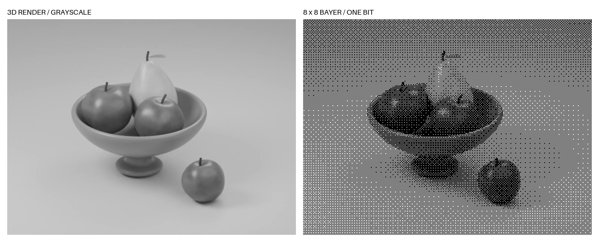

# apply dithering

An agent skill for implementing and debugging dithering in 3D scenes and games. It covers pattern selection, motion stability, shader math, color management, render order, and visual verification.

Based on Lucas Pope's [“Fullscreen, Round 3” TIGSource post](https://forums.tigsource.com/index.php?topic=40832.msg1363742#msg1363742), with an accessible [mirror hosted by the author](https://dukope.com/devlogs/obra-dinn/tig-32/). Attribution and supplementary sources are in [references/sources.md](references/sources.md).

## Rendered 3D example



A fruit vase modeled and rendered in Blender, then processed with the same Bayer rank construction as the skill's shader example. Both panels use the same 480x360 render, enlarged 2x with nearest-neighbor sampling.

The processor decodes sRGB, calculates linear Rec.709 luminance from Blender's display-transformed PNG, and compares it with `(rank + 0.5) / 64`. The left panel displays that luminance as sRGB grayscale; the right uses only black and white. This is a static screen-space example; motion stability needs a separate in-engine check.

[Editable Blender scene](examples/fruit-vase/fruit-vase.blend) · [Color render](examples/fruit-vase/color-render.png) · [Grayscale](assets/fruit-vase-grayscale.png) · [One-bit result](assets/fruit-vase-bayer8.png)

Reproduce with Blender and Python/Pillow:

```sh
blender --background --python examples/fruit-vase/scene.py -- --output examples/fruit-vase
python3 -m pip install 'Pillow>=10.1'
python3 examples/fruit-vase/apply_dither.py
```

[scene.py](examples/fruit-vase/scene.py) creates the geometry, materials, camera, lighting, `.blend`, and render. [apply_dither.py](examples/fruit-vase/apply_dither.py) applies the threshold effect and builds the comparison.

## Install in Codex

Clone into your personal skills directory. If `apply-dithering` already exists there, inspect it before replacing or updating it.

```sh
mkdir -p ~/.codex/skills
git clone https://github.com/DenisSergeevitch/apply-dithering.git ~/.codex/skills/apply-dithering
```

Restart or reload the agent's skill discovery if necessary. Other agents that support `SKILL.md` can use the same skill folder in their configured discovery directory.

## Use

```text
Use $apply-dithering to fix swimming and flicker in this 3D scene's
one-bit post-processing shader. Keep the two-color look and check
slow camera rotation, strafing, and moving objects.
```

The display name is **apply dithering**; its portable folder/invocation identifier is `apply-dithering`.

## Contents

- [SKILL.md](SKILL.md): decision workflow, integration invariants, diagnosis, and acceptance checks.
- [mapping-and-shaders.md](references/mapping-and-shaders.md): portable GLSL helpers and mapping recipes; adapt them to the project's engine.
- [sources.md](references/sources.md): provenance and limits of the source material.
- [agents/openai.yaml](agents/openai.yaml): Codex discovery metadata.

The skill distinguishes camera rotation from translation and object motion. It does not claim that a directional sphere mapping attaches dithering to surfaces, or that softened output remains strictly binary.

## License

[MIT](LICENSE) for the original skill instructions and examples. Linked articles, projects, and assets retain their own licenses; no original Obra Dinn code or media is included.
